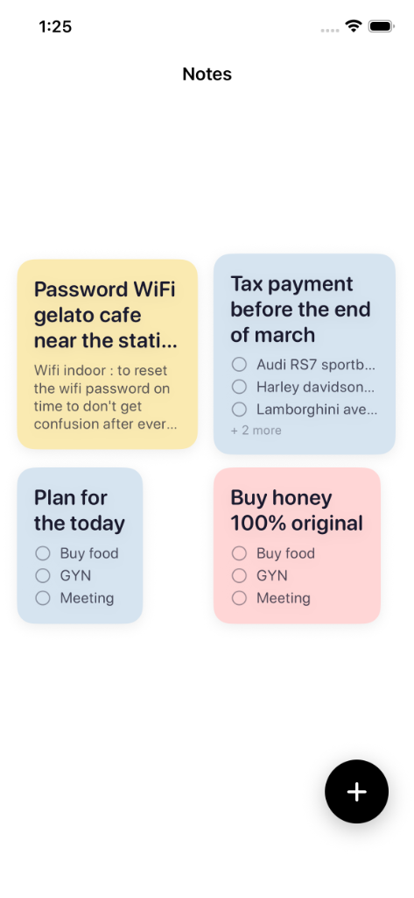
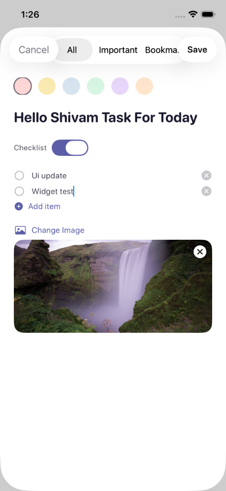
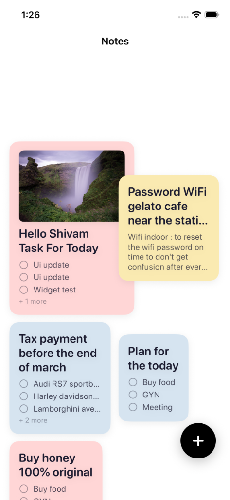

# NotesApp (iOS)

A modern, beautifully designed notes and task management application built natively with **SwiftUI** and **SwiftData** for iOS 17+.

Features a masonry card layout, rich color-coded organization, checklist management, image attachments, and fluid animations.

---

## 📱 Preview

<div align="center">

| Notes Overview | Create & Edit Note | Rich Media Cards |
| :---: | :---: | :---: |
|  |  |  |

</div>

---

## ✨ Features

- **Masonry Grid Layout**: Responsive, multi-column card layout displaying notes with natural vertical height balancing.
- **Categorization & Tabs**: Quickly filter between **All**, **Important**, and **Bookmarked** with dynamic live count badges.
- **Rich Note Types**:
  - **Text Notes**: Markdown-friendly note taking with expandable title and body editing.
  - **Interactive Checklists**: Todo items with instant completion toggles and inline addition.
- **Image Attachments**: Attach photos directly from your library using `PhotosUI`.
- **Vibrant Pastel Color Palette**: Choose custom accent colors for each note (Pink, Yellow, Blue-Gray, Green, Purple, Orange).
- **SwiftData Persistence**: Fully local-first, privacy-focused persistence with cascading relationships for checklist items.
- **Dark Mode Support**: Adaptive color schemes tailored for both light and dark aesthetics.
- **Fluid Micro-Interactions**: Spring-animated Floating Action Button (FAB), quick context-menu deletions, and smooth transitions.
- **Out-of-the-Box Sample Data**: Pre-seeded demo notes on first launch so the UI is ready to explore immediately.

---

## 🛠️ Tech Stack & Requirements

| Specification | Detail |
|---|---|
| **Platform** | iOS 17.0+ |
| **Language** | Swift 5.9+ |
| **UI Framework** | SwiftUI |
| **Data Persistence** | SwiftData (`@Model`, `ModelContainer`, `ModelContext`) |
| **State Management** | Swift Observation (`@Observable`) |
| **Development Tool** | Xcode 15.0+ |

---

## 🏗️ Architecture & Project Structure

The project follows the **MVVM** pattern with modular component separation:

```text
notes_app/
├── screenshots/                       # Application preview screenshots
│   ├── preview_1.png                  # Home screen - Masonry grid
│   ├── preview_2.png                  # Create/Edit note sheet with checklist & image
│   └── preview_3.png                  # Rich media notes overview
├── README.md                          # Documentation
└── NotesApp/
    ├── NotesApp.xcodeproj             # Xcode project file
    ├── generate_colors.py             # Asset catalog color generator script
    └── NotesApp/
        ├── NotesAppApp.swift          # Main entry point with SwiftData container
        ├── Models/
        │   └── Note.swift             # SwiftData models: Note & ChecklistItem
        ├── ViewModels/
        │   └── NotesViewModel.swift   # Filtering, counts, seed data, and CRUD logic
        ├── Views/
        │   ├── HomeView.swift         # Main dashboard with masonry grid & tabs
        │   ├── NoteDetailView.swift   # Reading, editing, & interactive checklists
        │   └── AddNoteView.swift      # Sheet for creating notes with colors/images
        ├── Components/
        │   ├── MasonryGrid.swift      # 2-column Pinterest-style layout engine
        │   ├── NoteCard.swift         # Dynamic note card component
        │   ├── CategoryTabBar.swift   # Pill-style category switcher
        │   └── FABButton.swift        # Floating action button with spring press
        └── Resources/
            ├── Theme.swift            # Design tokens, color palette, & typography
            └── Assets.xcassets/       # Adaptive color assets & app icon
```

---

## 🚀 Getting Started

### Prerequisites

- macOS Sonoma 14.0 or later
- Xcode 15.0 or later
- iOS 17.0+ Simulator or physical device

### Installation & Run

1. **Clone the repository:**
   ```bash
   git clone https://github.com/shiv-stack/notes_app_ios.git
   cd notes_app_ios
   ```

2. **Open the project in Xcode:**
   ```bash
   open NotesApp/NotesApp.xcodeproj
   ```

3. **Build & Run:**
   - Select an iOS 17+ Simulator (e.g., iPhone 15 Pro).
   - Press `Cmd + R` or tap the **Play** button in Xcode to build and launch the app.

---

## 🎨 Asset Colors Generation (Optional)

If you ever wish to regenerate or customize the adaptive asset color catalog programmatically, run:

```bash
cd NotesApp
python3 generate_colors.py
```

---

## 📄 License

This project is licensed under the MIT License - feel free to use and modify it for your own projects!
